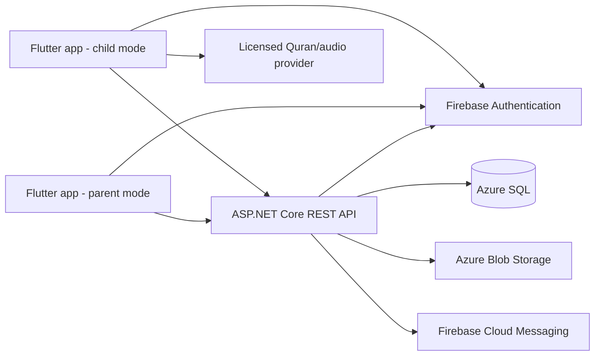

# البنية الأولية

## المكونات



## حدود المسؤولية

- **Flutter:** واجهات عربية/إنجليزية، قواعد عرض محلية، تخزين مؤقت محدود، وطابور أحداث للتعلم دون اتصال. لا يقرر العميل ملكية الأسرة ولا يمنح النقاط النهائية.
- **ASP.NET Core:** التحقق من Firebase ID token، التفويض على كل مورد، التحقق من الإدخال، قواعد الأهداف والمكافآت، idempotency، وتسجيل الأحداث التشغيلية دون محتوى حساس.
- **قاعدة البيانات:** مخطط SQL Server/Azure SQL لملفات الأطفال والجلسات؛ يستخدم SQLite افتراضيًا في Development/Testing. يتحقق بدء البيئات الأخرى من إعداد Firebase Project ID وسلسلة الاتصال، ولا يطبق migrations تلقائيًا؛ ينفذها مسار نشر منفصل بعد مراجعة سكربت SQL idempotent.
- **Firebase:** إثبات الهوية وإشعارات اختيارية. يظل الخادم هو مرجع الصلاحية.
- **Azure Blob:** ملفات ثابتة/حزم صوتية عند امتلاك حق التخزين والتوزيع. لا تخزن تسجيلات الطفل في MVP.

## تنظيم المستودع المقترح

```text
mobile/
  lib/app/                 # bootstrap, routing, theme, localization
  lib/core/                # networking, storage, errors, shared widgets
  lib/features/<feature>/  # data/domain/presentation
  test/
backend/
  src/QuranHero.Domain/
  src/QuranHero.Application/
  src/QuranHero.Infrastructure/
  src/QuranHero.Api/
  tests/QuranHero.UnitTests/
  tests/QuranHero.IntegrationTests/
database/
  migrations/
  seed/
docs/
.github/workflows/
```

## واجهة البرمجة

- بادئة `/api/v1`، JSON UTF-8، HTTPS فقط.
- هوية المستخدم تأتي من token موثق؛ لا يقبل الخادم `parentId` كمرجع صلاحية من جسم الطلب.
- قوائم النتائج محددة بصفحات، وأخطاء بصيغة RFC 9457 Problem Details.
- `POST /api/v1/children/{childId}/study-sessions` يقبل `clientEventId` ثابتًا من العميل؛ إعادة المحاولة المطابقة تعيد السجل الحالي، وإعادة استخدام المعرف مع حمولة مختلفة تعيد `409`.
- المسارات المنفذة: CRUD/أرشفة `/api/v1/children`، وتسجيل/قراءة `/api/v1/children/{childId}/study-sessions`، وتجميع عدد ومدة جميع جلسات الطفل في `/api/v1/children/{childId}/study-sessions/summary` بعد التحقق من الملكية، إضافة إلى `/health`.
- تستخدم لوحة Flutter الرئيسية مسار الملخص الشامل، بينما يبقى سجل التعلم التفصيلي على مسار القائمة؛ بعد حفظ جلسة يُعاد تحميل مزودي الملخص والسجل.
- وثيقة OpenAPI v1 تصف نماذج الطلب والاستجابة والأخطاء وقيود الحقول؛ متطلبات Bearer مربوطة بالعمليات المحمية فقط. Swagger UI/JSON مفعلان في Development/Testing ولا يُكشفان في Production؛ `/health` عام.
- مسارات الهوية والأهداف والمكافآت والتقارير والمحتوى القرآني ما زالت ضمن الخطة وليست منفذة بعد.

## نمط العمل دون اتصال

- تخزين محلي للبيانات العامة/المرخصة المطلوبة فقط، مع معرف نسخة المحتوى.
- كل نشاط محلي يحمل معرفًا عالميًا ووقت وقوع ووقت مزامنة.
- إرسال دفعات مع idempotency، وإظهار حالة مزامنة مفهومة.
- لا تُستبدل حقيقة حدث محلي بوقت وصوله للخادم؛ تسوية التعارض موثقة وقابلة للتدقيق.

## قرارات مبدئية قابلة للمراجعة

1. اعتماد Riverpod للعميل لتسهيل فصل الحالة والاختبارات؛ مزود token الحالي لا يصدر رموزًا حتى ربط Firebase.
2. فصل طبقات .NET إلى Domain/Application/Infrastructure/Api؛ لا تُفرض microservices قبل وجود حاجة قياسية.
3. استخدام Azure SQL بدل تخزين مستندات مرنة لأن العلاقات والقيود وسجل الإنجاز مهمة.
4. تأجيل AI والصوت والميزات الاجتماعية إلى ما بعد MVP ومراجعة الخصوصية والدقة.
5. لا تُنزّل أو تدمج خدمة محتوى قبل موافقة مالك المشروع على الشروط المبينة في `docs/product/content-sources.md`.

## التشغيل والرصد

بيئات منفصلة للتطوير والاختبار والإنتاج؛ الأسرار عبر مخزن أسرار المنصة؛ سجلات منظمة ومعرّف ارتباط؛ metrics للأخطاء والكمون والطوابير، دون تسجيل نصوص التلاوة أو أسماء الأطفال. النسخ الاحتياطي واختبار الاستعادة جزء من جاهزية الإنتاج.
