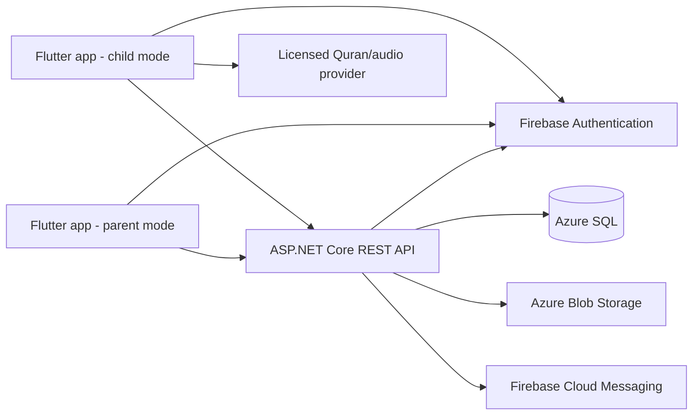

# البنية الأولية

## المكونات



## حدود المسؤولية

- **Flutter:** واجهات عربية/إنجليزية، قواعد عرض محلية، تخزين مؤقت محدود، وطابور أحداث للتعلم دون اتصال. لا يقرر العميل ملكية الأسرة ولا يمنح النقاط النهائية.
- **ASP.NET Core:** التحقق من Firebase ID token، التفويض على كل مورد، التحقق من الإدخال، قواعد الأهداف والمكافآت، idempotency، وتسجيل الأحداث التشغيلية دون محتوى حساس.
- **Azure SQL:** بيانات الحسابات والأسر والملفات ومراجع المحتوى وسجلات التعلم والمكافآت.
- **Firebase:** إثبات الهوية وإشعارات اختيارية. يظل الخادم هو مرجع الصلاحية.
- **Azure Blob:** ملفات ثابتة/حزم صوتية عند امتلاك حق التخزين والتوزيع. لا تخزن تسجيلات الطفل في MVP.

## تنظيم المستودع المقترح

```text
mobile/
  lib/app/                 # bootstrap, routing, theme, localization
  lib/core/                # networking, storage, errors, shared widgets
  lib/features/<feature>/  # data/domain/presentation
  test/
backend/
  src/QuranHero.Domain/
  src/QuranHero.Application/
  src/QuranHero.Infrastructure/
  src/QuranHero.Api/
  tests/QuranHero.UnitTests/
  tests/QuranHero.IntegrationTests/
database/
  migrations/
  seed/
docs/
.github/workflows/
```

## واجهة البرمجة

- بادئة `/api/v1`، JSON UTF-8، HTTPS فقط.
- هوية المستخدم تأتي من token موثق؛ لا يقبل الخادم `parentId` كمرجع صلاحية من جسم الطلب.
- قوائم النتائج محددة بصفحات، وأخطاء بصيغة RFC 9457 Problem Details.
- عمليات تسجيل الجلسات تقبل `Idempotency-Key` لمنع تكرار الأثر عند إعادة المحاولة.
- مسارات مقترحة: `/me`, `/children`, `/quran/surahs`, `/study-sessions`, `/goals`, `/rewards`, `/reports/summary`.

## نمط العمل دون اتصال

- تخزين محلي للبيانات العامة/المرخصة المطلوبة فقط، مع معرف نسخة المحتوى.
- كل نشاط محلي يحمل معرفًا عالميًا ووقت وقوع ووقت مزامنة.
- إرسال دفعات مع idempotency، وإظهار حالة مزامنة مفهومة.
- لا تُستبدل حقيقة حدث محلي بوقت وصوله للخادم؛ تسوية التعارض موثقة وقابلة للتدقيق.

## قرارات مبدئية قابلة للمراجعة

1. اعتماد Riverpod للعميل لتسهيل فصل الحالة والاختبارات.
2. فصل طبقات .NET إلى Domain/Application/Infrastructure/Api؛ لا تُفرض microservices قبل وجود حاجة قياسية.
3. استخدام Azure SQL بدل تخزين مستندات مرنة لأن العلاقات والقيود وسجل الإنجاز مهمة.
4. تأجيل AI والصوت والميزات الاجتماعية إلى ما بعد MVP ومراجعة الخصوصية والدقة.
5. لا تختار خدمة محتوى قبل تدقيق الترخيص والمصدر.

## التشغيل والرصد

بيئات منفصلة للتطوير والاختبار والإنتاج؛ الأسرار عبر مخزن أسرار المنصة؛ سجلات منظمة ومعرّف ارتباط؛ metrics للأخطاء والكمون والطوابير، دون تسجيل نصوص التلاوة أو أسماء الأطفال. النسخ الاحتياطي واختبار الاستعادة جزء من جاهزية الإنتاج.
