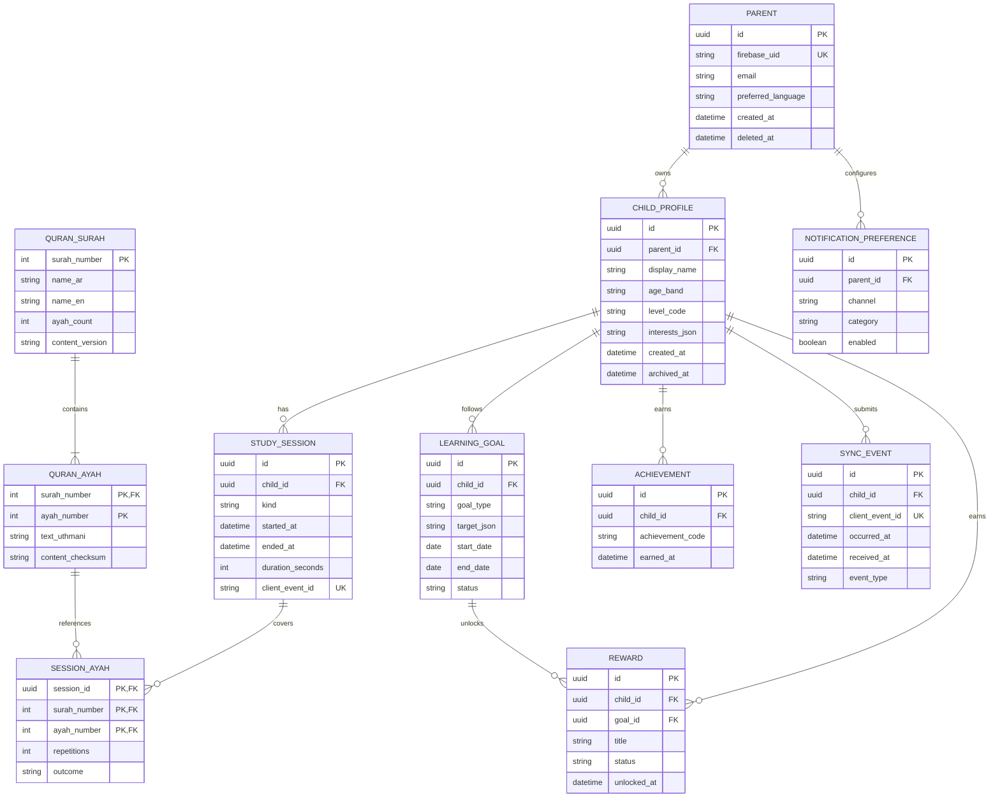

# نموذج البيانات الأولي وERD

> هذا ERD تصور كامل مرحلي للمنتج. المخطط المنفذ الآن يغطي ملفات الأطفال وجلسات التعلم فقط؛ راجع EF migration في `backend/src/QuranHero.Infrastructure/Persistence/Migrations/` للتفاصيل الحالية. تستخدم ملفات الأطفال فئة عمرية عامة ولا تخزن تاريخ ميلاد دقيقًا.

## قواعد وقيود أساسية

- `PARENT.firebase_uid` فريد، ويُربط بحساب المصادقة بعد تحقق الخادم من الرمز.
- جميع كيانات الطفل تحمل `child_id` أو `parent_id` لازمًا لمسار التفويض؛ الاستعلامات تقيد دائمًا بهوية الأب/الأم المستخرجة من token.
- `QURAN_AYAH` مفتاح مركب `(surah_number, ayah_number)`، مع تحقق من مدى الأرقام ومطابقة إصدار المصدر.
- `client_event_id` فريد لمنع مضاعفة جلسة/نقاط عند إعادة المزامنة.
- التواريخ تخزن UTC، وتُحسب أهداف اليوم والسلسلة وفق المنطقة الزمنية المسجلة لولي الأمر.
- حالات المكافأة المقترحة: `locked`, `unlocked`, `claimed`, `cancelled`؛ انتقالاتها يقررها الخادم.
- الحذف يراعي فصل حذف الحساب عن البيانات اللازمة للسجل القانوني أو المحاسبي إن وجدت؛ تفاصيل الاحتفاظ تتطلب قرارًا قانونيًا حسب السوق.

## فهارس مرشحة

- فريد على `Parent(firebase_uid)`.
- `(ChildProfile.parent_id, ChildProfile.archived_at)` لتعداد الأبناء النشطين.
- `(StudySession.child_id, StudySession.started_at DESC)` لتقارير النشاط.
- فريد على `(SyncEvent.child_id, SyncEvent.client_event_id)`.
- `(LearningGoal.child_id, LearningGoal.status, LearningGoal.end_date)`.
- `(Achievement.child_id, Achievement.earned_at DESC)`.

لا تُنشأ جداول للأصدقاء أو التسجيلات الصوتية أو محتوى مولد آليًا في MVP.
